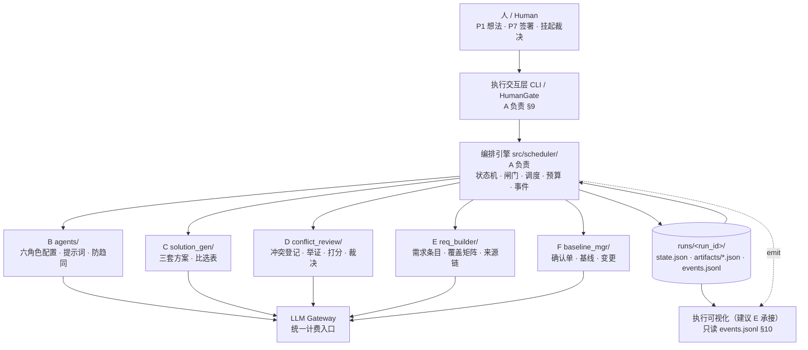
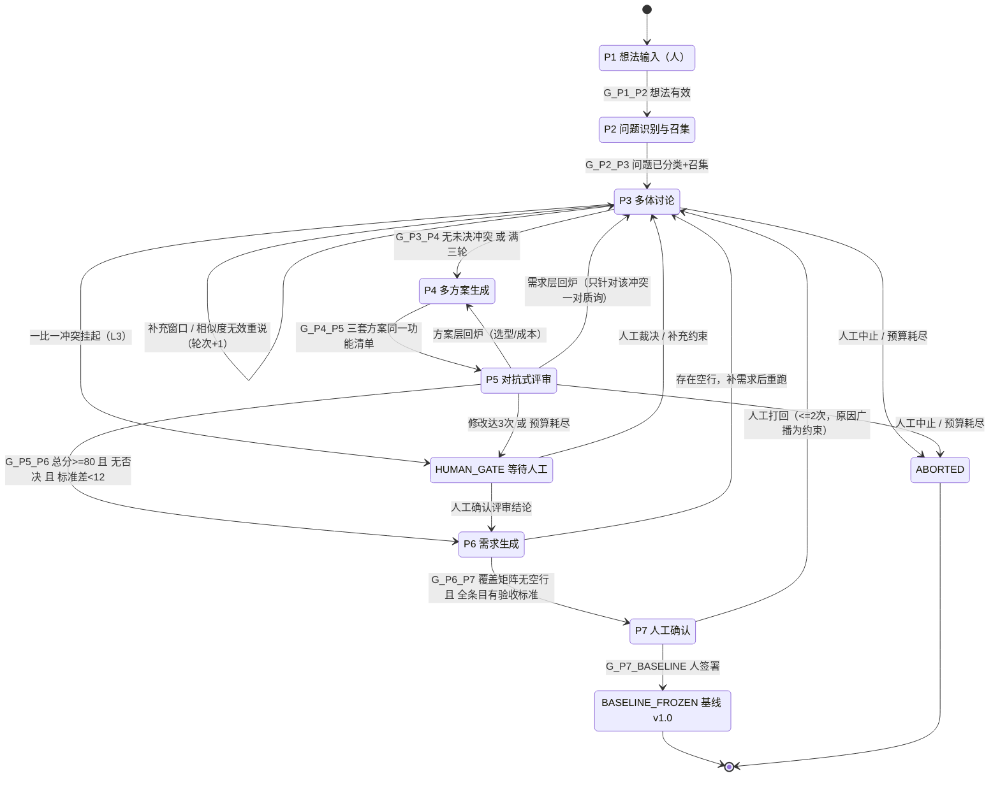
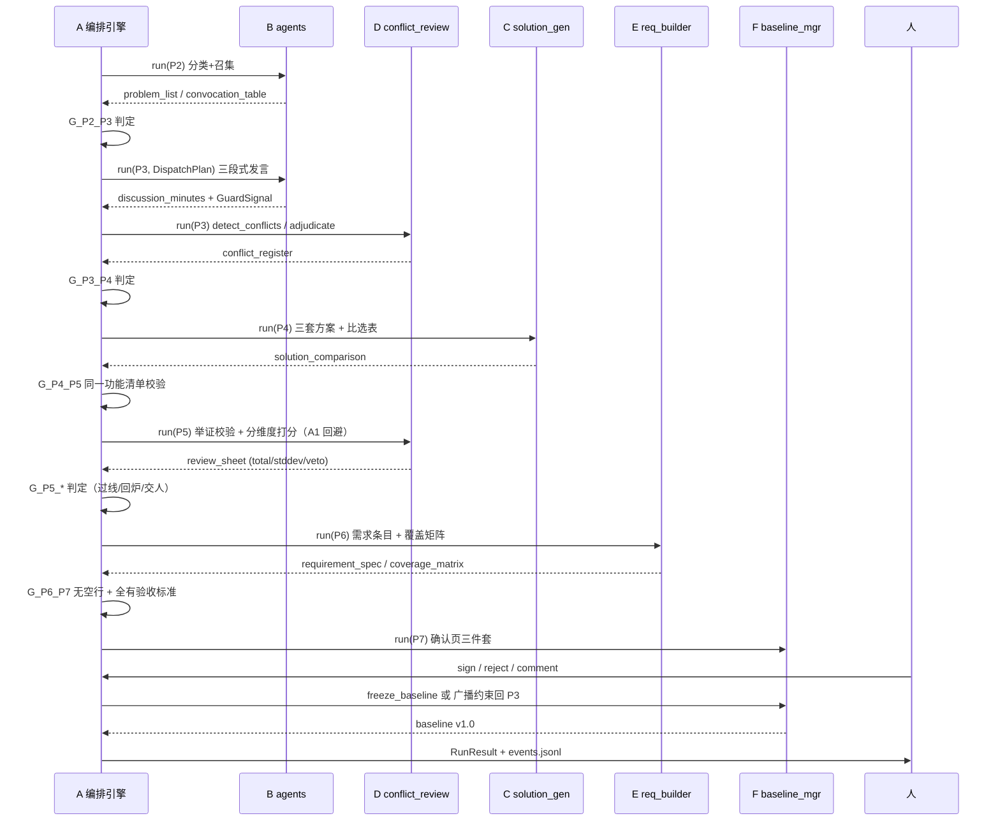

# architecture.md — 总体架构、状态机、阶段闸门与统一数据契约

| 项 | 值 |
| --- | --- |
| 负责人 | A（产品经理 / 系统编排调度者） |
| 分支 | `feature/A-scheduler-statemachine` |
| 状态 | 设计稿 v0.1（待步骤 3 设计评审会对齐后升 v1.0） |
| 对应代码 | `src/scheduler/`（`statemachine.py` / `flow.yaml` / `gate_rule.yaml`） |
| 上游依据 | `第10组-多智能体需求生成工作流.docx` + 课堂给的六阶段框架 + 组内分工表 |
| 下游依赖 | B/C/D/E/F 五份设计文档与模块实现 |

> **⚠️ 全组先读 §0。** 按组内约定，**数据契约统一由 A 在本文开头定义**，B/C/D/E/F 的文档**只引用、不重复定义**同名字段。任何字段名、类型、枚举值的变更，必须先提 PR 改本文 §0，再改各自模块，否则 A 的编排引擎会在对接时直接校验失败。
>
> **本文边界**：只做设计，不含真实业务代码。§4/§5/§6 的 YAML 是**内嵌草案**，编码阶段（步骤 4）原样落盘为 `src/scheduler/gate_rule.yaml` 与 `src/scheduler/flow.yaml`。

## 产出标准自检（PR review 用）

| 设计稿产出标准 | 本文对应章节 |
| --- | --- |
| 这个模块输入是什么？输出是什么？ | §2 系统输入输出、§8.1 统一调用协议、§8.2 各模块签名 |
| 数据长什么样（示例 JSON/YAML） | §0.4 / §0.5 全部共享表、§2、§3.4、§4.3、§5.2、§7.1、§9.3、§10.2 |
| 核心流程伪代码 | §4.5、§5.4、§6.4、§7.4、§11 |
| 和哪些模块交互、数据怎么兼容 | §1.2 模块归属表、§8（含时序图）、§0.6 兼容性硬规则、§14 评审对齐清单 |

---

## 0. 统一数据契约（Single Source of Truth）

### 0.1 交换原则（六条硬约束）

1. **运行时产物一律 JSON**（UTF-8，snake_case 字段），落盘到 `runs/<run_id>/artifacts/<artifact>.json`；**配置一律 YAML**，只允许存在于 `src/scheduler/flow.yaml`、`src/scheduler/gate_rule.yaml`、`src/agents/agent_config.yaml`。
2. 模块之间**禁止互相 import 对方内部结构**、禁止直接改对方产物文件；所有跨模块数据只能通过 §0.4 的 `StageContext` / `StageResult` 信封传递，由编排引擎落盘。
3. 每个产物必须带 `meta`：`schema_version` / `run_id` / `stage` / `produced_by` / `created_at`（ISO 8601）。缺 `meta` 的产物编排引擎拒收。
4. 公共字段名与类型由本表锁定；模块私有数据一律放进 `extensions: {}`，不得新增同名但不同类型的字段。
5. 所有枚举集中在 §0.2，代码里禁止出现魔法字符串。
6. 所有引用统一用 `source_ref`：格式 `"<artifact>:<id>"`，例如 `"conflict_register:CFL-003"`、`"solution_comparison:FEA-002.adopted"`。禁止用自由文本描述来源。

### 0.2 全局枚举（锁定）

| 枚举 | 取值 |
| --- | --- |
| `StageId` | `P1` `P2` `P3` `P4` `P5` `P6` `P7` |
| `RunStatus` | `running` `waiting_human` `frozen` `escalated` `aborted` |
| `AgentId` | `A1` 产品经理 `A2` 用户代表 `A3` 技术架构师 `A4` 质量评审员 `A5` 需求分析师 `A6` 需求确认员 |
| `AgentFamily` | `deliberative`（协商族 A1–A4，有立场） `processing`（加工族 A5–A6，无立场） |
| `ProblemType` | `functional` `technical` `cost` `risk`（允许多标签） |
| `ConfidenceBand` | `high` `low`（`low` 触发全员召集） |
| `TopicId` | 来自固定议题词表（B 维护，`agent_config.yaml#topic_vocabulary`），禁止角色自造议题名 |
| `ConflictLevel` | `L1_evidence`（证据可裁决） `L2_weighted_vote`（权重投票） `L3_escalate`（一比一挂起交人） |
| `ConflictStatus` | `open` `resolved` `escalated` |
| `ResolutionType` | `evidence` `weighted_vote` `escalate` `rework_required` |
| `SolutionId` | `SOL_A`（成本优先） `SOL_B`（体验优先） `SOL_C`（扩展优先） |
| `Severity` | `blocking` `major` `minor` |
| `Priority` | `must` `should` `could` `wont`（MoSCoW） |
| `HumanAction` | `approve` `reject` `comment` `sign` `adjudicate` |
| `GateAction` | `advance` `stay` `rework` `escalate` `wait_human` `abort` `freeze` |
| `TerminationReason` | `baseline_signed` `conflict_no_open` `max_rounds` `budget_exhausted` `human_abort` `rework_limit` `error` |
| `ErrorCode` | `E_ARTIFACT_MISSING` `E_SCHEMA_INVALID` `E_GATE_UNSATISFIED` `E_BUDGET_EXHAUSTED` `E_AGENT_UNAVAILABLE` `E_HUMAN_TIMEOUT` |

### 0.3 ID 规范与追溯链

| 对象 | 格式 | 产生者 | 被谁引用 |
| --- | --- | --- | --- |
| 运行实例 | `R0001` | A | 全部 |
| 问题条目 | `PRB-001` | A（P2 分类结果） | 召集表、冲突登记表、覆盖矩阵 |
| 冲突条目 | `CFL-001` | D | 质询、裁决、覆盖矩阵行 |
| 功能项 | `FEA-001` | C（三套方案共用清单） | 比选表行、需求条目来源 |
| 方案变体 | `SOL_A/B/C` | C | 比选表列、采纳列 |
| 质疑条目 | `CHG-001` | D | 覆盖矩阵行、意见处理表 |
| 需求条目 | `REQ-001` | E | 覆盖矩阵列、基线、确认单 |
| 变更请求 | `CR-001` | F | 基线 v1.1 |
| 事件序号 | `EVT-00001` | A | 可视化（E） |
| 基线版本 | `v1.0` / `v1.1` | F | 需求条目 `baseline_version` |

追溯链（**评审会必须逐环核对**）：
`idea(P1) → PRB(P2) → CFL(P3) → FEA/SOL(P4) → CHG/score(P5) → REQ(P6) → coverage(P6) → baseline(P7)`。

### 0.4 公共信封（所有模块共用，A 实现）

```python
# src/scheduler/context.py —— 设计签名，编码阶段落地
from dataclasses import dataclass, field
from typing import Any, Literal

@dataclass
class ArtifactMeta:
    schema_version: str            # "1.0"
    run_id: str                    # "R0001"
    stage: str                     # StageId
    produced_by: str               # module_id, 如 "conflict_review"
    created_at: str                # ISO 8601

@dataclass
class BudgetLedger:
    global_limit: int              # 默认 30，来自 RunConfig
    global_used: int
    per_stage_limit: dict[str, int]
    per_stage_used: dict[str, int]
    rounds: dict[str, int]         # {"P3": 2, "P5": 1}
    rework_count: int              # P7 打回次数
    p5_revision_count: int         # P5 修改次数

@dataclass
class StageContext:
    run_id: str
    stage: str
    round_index: int
    dispatch_plan: dict[str, Any] | None   # §6，仅协商阶段有
    artifacts: dict[str, Any]              # 只读快照：本阶段允许消费的产物
    config: dict[str, Any]                 # flow.yaml 中本阶段配置 + 约束广播
    ledger: BudgetLedger                   # 只读，模块不得自行改写
    constraints: list[str]                 # 人工打回原因广播、新约束

@dataclass
class GuardSignal:
    """B/D 模块产生的防退化信号，A 只消费、不解释语义。"""
    signal: Literal["similarity_invalid", "force_speak", "challenge_downweight", "low_confidence"]
    agent_id: str | None
    value: float | None
    reason: str

@dataclass
class RunEvent:
    event_id: str
    run_id: str
    ts: str
    stage: str
    event_type: str                # §10.1
    actor: str                     # module_id | agent_id | "human" | "scheduler"
    payload_ref: str               # "artifacts/xxx.json#..." 或内联摘要
    budget_used: int

@dataclass
class StageResult:
    stage: str
    status: Literal["ok", "blocked", "need_human", "failed"]
    artifacts: dict[str, Any]      # {artifact_name: {...}}，每个对象须带 meta
    events: list[RunEvent]
    guard_signals: list[GuardSignal]
    budget_used: int               # 本次真实 LLM 调用次数，由 A 计费
    errors: list[dict[str, Any]]   # {code: ErrorCode, message: str}

@dataclass
class RunState:
    run_id: str
    status: str                    # RunStatus
    phase: str                     # StageId | "HUMAN_GATE" | "BASELINE_FROZEN" | "ABORTED"
    round_index: int
    artifacts_index: dict[str, str]   # {artifact_name: 相对路径}
    ledger: BudgetLedger
    constraints: list[str]
    last_gate_verdict: dict[str, Any] | None
    human_decisions: list[dict[str, Any]]
    updated_at: str
```

`Artifact` 最小合法 JSON（所有产物都长这个壳）：

```json
{
  "meta": {
    "schema_version": "1.0",
    "run_id": "R0001",
    "stage": "P3",
    "produced_by": "conflict_review",
    "created_at": "2026-11-10T14:02:31+08:00"
  },
  "data": {},
  "extensions": {}
}
```

> 约定：`data` 是各表正文（§0.5），`extensions` 放模块私有字段。**A 的校验器只校验 `meta` + §0.5 声明的必填字段**，不干涉 `extensions`。

### 0.5 四张必须对齐的共享表（重点坑）

| 表 / artifact 名 | 主责 | 产出 | 消费 | 主键 | 必填字段（最小集） |
| --- | --- | --- | --- | --- | --- |
| `conflict_register.json` | D | P3 | P3 质询 / P5 裁决 / P6 覆盖矩阵 | `conflict_id` | `topic_id`, `stances[]`, `level`, `status`, `source_refs[]` |
| `solution_comparison.json` | C | P4 | P5 打分 / P6 需求生成 / P7 确认单 | `feature_id` | `feature_items[]`, `rows[]`, `rows[].options`, `rows[].adopted` |
| `requirement_spec.json` | E | P6 | P6 覆盖矩阵 / P7 基线 / F 变更 | `req_id` | `title`, `description`, `acceptance_criteria[]`, `priority`, `source_refs[]` |
| `coverage_matrix.json` | E | P6 | P6→P7 闸门 / P7 确认页 | `source_id` | `rows[]`, `rows[].covered_by[]`, `coverage_rate` |

#### 0.5.1 `conflict_register.json`（D 实现，A 只读）

```json
{
  "meta": {"schema_version": "1.0", "run_id": "R0001", "stage": "P3", "produced_by": "conflict_review", "created_at": "2026-11-10T14:05:00+08:00"},
  "data": {
    "conflicts": [
      {
        "conflict_id": "CFL-001",
        "topic_id": "message_channel",
        "problem_refs": ["problem_list:PRB-002"],
        "stances": [
          {"agent_id": "A2", "position": "must_have_read_receipt", "quote_ref": "statement:ST-002-01", "evidence_refs": []},
          {"agent_id": "A3", "position": "reuse_oss_component", "quote_ref": "statement:ST-003-01", "evidence_refs": ["cost_estimate:CE-001"]}
        ],
        "level": "L1_evidence",
        "status": "resolved",
        "resolution": {"type": "evidence", "winner": "A3", "decided_by": "conflict_review", "reason": "有开源组件复用成本数据", "round_index": 2},
        "source_refs": ["statement:ST-002-01", "statement:ST-003-01"]
      }
    ],
    "open_count": 0,
    "escalated_ids": []
  },
  "extensions": {}
}
```

#### 0.5.2 `solution_comparison.json`（C 实现，A 只读）

```json
{
  "meta": {"schema_version": "1.0", "run_id": "R0001", "stage": "P4", "produced_by": "solution_gen", "created_at": "2026-11-10T14:12:00+08:00"},
  "data": {
    "feature_items": [
      {"feature_id": "FEA-001", "title": "站内消息", "source_ref": "problem_list:PRB-002"},
      {"feature_id": "FEA-002", "title": "图片存储", "source_ref": "problem_list:PRB-003"}
    ],
    "solutions": [
      {"solution_id": "SOL_A", "strategy": "cost_first", "constraints_ref": "flow.yaml#shared_constraints"},
      {"solution_id": "SOL_B", "strategy": "experience_first", "constraints_ref": "flow.yaml#shared_constraints"},
      {"solution_id": "SOL_C", "strategy": "extensibility_first", "constraints_ref": "flow.yaml#shared_constraints"}
    ],
    "rows": [
      {
        "feature_id": "FEA-001",
        "options": {
          "SOL_A": {"description": "复用开源组件", "cost_estimate": 1, "risk": "low"},
          "SOL_B": {"description": "自研，带已读回执", "cost_estimate": 5, "risk": "medium"},
          "SOL_C": {"description": "抽象为消息中台", "cost_estimate": 8, "risk": "high"}
        },
        "adopted": {"solution_id": "SOL_B", "interaction": true, "implementation_from": "SOL_A", "rationale": "B 的交互 + A 的实现"},
        "source_refs": ["conflict_register:CFL-001"]
      }
    ],
    "adopted_ref": "baseline_decision"
  },
  "extensions": {}
}
```

> 硬约束：三套方案的 `feature_items` **必须是同一份、顺序一致、ID 一致**（闸门 `G_P4_P5` 靠它判）。`adopted` 列直接成为需求基线来源。

#### 0.5.3 `requirement_spec.json`（E 实现，A 只读）

```json
{
  "meta": {"schema_version": "1.0", "run_id": "R0001", "stage": "P6", "produced_by": "req_builder", "created_at": "2026-11-10T14:25:00+08:00"},
  "data": {
    "requirements": [
      {
        "req_id": "REQ-001",
        "title": "站内消息支持已读回执",
        "description": "用户发送站内消息后可查看对方已读状态",
        "acceptance_criteria": [
          {"given": "用户 A 已向用户 B 发送消息", "when": "用户 B 打开消息", "then": "消息状态变更为已读且 A 侧可见"}
        ],
        "priority": "must",
        "depends_on": [],
        "source_refs": ["solution_comparison:FEA-001.adopted", "conflict_register:CFL-001"],
        "baseline_version": "v1.0"
      }
    ],
    "hard_validation": {"all_have_acceptance_criteria": true}
  },
  "extensions": {}
}
```

> 硬校验（方案原文）：**任一条目缺 `acceptance_criteria`，整份规格不得进入 P7**。这条由闸门 `G_P6_P7` 兜底，A 不信任 E 的自检结果，会自己扫一遍。

#### 0.5.4 `coverage_matrix.json`（E 实现，A 只读）

```json
{
  "meta": {"schema_version": "1.0", "run_id": "R0001", "stage": "P6", "produced_by": "req_builder", "created_at": "2026-11-10T14:26:00+08:00"},
  "data": {
    "rows": [
      {"source_type": "conflict", "source_id": "CFL-001", "source_ref": "conflict_register:CFL-001", "covered_by": ["REQ-001"], "status": "covered"},
      {"source_type": "challenge", "source_id": "CHG-004", "source_ref": "review_sheet:CHG-004", "covered_by": [], "status": "gap"}
    ],
    "columns": ["REQ-001", "REQ-002"],
    "gap_count": 1,
    "coverage_rate": 0.5
  },
  "extensions": {}
}
```

> 行 = 冲突清单 + 评审问题清单；列 = 需求条目；**空行即遗漏**。`gap_count == 0` 才允许进 P7。

#### 0.5.5 其余产物（A 定义骨架，各模块实现）

| artifact | 主责 | 阶段 | 关键字段（最小集） |
| --- | --- | --- | --- |
| `idea_card.json` | A | P1 | `idea_text`, `author`, `constraints[]` |
| `problem_list.json` | A | P2 | `problems[]`: `problem_id`, `types[]`(ProblemType), `confidence`, `owner_roles[]`(AgentId) |
| `convocation_table.json` | A | P2 | `by_problem`, `on_stage[]`, `reason`(含 `low_confidence_all_hands`) |
| `discussion_minutes.json` | B | P3 | `statements[]`, `query_pairs[]`, `votes[]`, `supplements[]` |
| `review_sheet.json` | D | P5 | `challenges[]`: `challenge_id`, `description`, `impact_ref`, `severity`, `consequence`, `rejected`; `scores[]`, `weighted_total`, `stddev`, `veto` |
| `opinion_handling.json` | F | P7 | `opinions[]`: `ref`, `decision`(`adopt`/`reject`/`pending`), `reason` |
| `baseline.json` | F | P7 | `version`, `requirement_ids[]`, `signed_by`, `signed_at`, `frozen` |
| `change_request.json` | F | P7 后 | `cr_id`, `from_version`, `impact_analysis`, `review_result`, `to_version` |

### 0.6 兼容性硬规则（评审会逐条签字）

| # | 规则 | 违反后果 |
| --- | --- | --- |
| C1 | `conflict_register.conflicts[].conflict_id` 必须能在 `coverage_matrix.rows[]` 找到 `source_id` | 覆盖率算不出来，`G_P6_P7` 恒 false |
| C2 | `coverage_matrix.rows[].covered_by[]` 中的 ID 必须存在于 `requirement_spec.requirements[].req_id` | A 的引用完整性校验抛 `E_SCHEMA_INVALID` |
| C3 | `requirement_spec.requirements[].source_refs` 必须能解析到 `solution_comparison:FEA-*.adopted` 或 `conflict_register:CFL-*` | 追溯链断裂，F 无法出确认单 |
| C4 | `solution_comparison.feature_items` 对 SOL_A/B/C 完全一致 | `G_P4_P5` 不通过，P4 原地重跑 |
| C5 | 所有产物带 `meta`，`schema_version == "1.0"` | 编排引擎拒收 |
| C6 | 模块只能返回 `StageResult`，不得自行写 `runs/` 或改 `RunState` | 状态与事件流不一致，无法重放 |
| C7 | 字段类型变更 → 先改本文 §0 并 review | 对接直接崩 |

---

## 1. 系统边界与总体架构

### 1.1 边界（继承方案原文）

- **做**：把一句模糊想法，经多智能体讨论/比选/评审，变成条目化、可签字的需求基线；全过程留痕。
- **不做**：代码生成、需求正确性证明、无人值守。人只做两件事——提想法（P1）与做取舍（P7 / 挂起裁决）。
- **技术选型**：自研轻量编排（YAML + 状态机），不套 AutoGen。理由：`GroupChat` 把"下一个谁说话"交给模型决定，而本方案最需要精确控制的就是这一点。

### 1.2 分层架构



### 1.3 模块归属与仓库路径映射

| 代号 | 模块 `module_id` | 设计文档 | 代码目录 | A 何时调用 |
| --- | --- | --- | --- | --- |
| A | `scheduler` | `docs/architecture.md`（本文） | `src/scheduler/` | 常驻主控 |
| B | `agents` | `docs/agent-roles.md` | `src/agents/` | P2 召集、P3 讨论、P5 回避校验 |
| C | `solution_gen` | `docs/multi-solution.md` | `src/solution_gen/` | P4、P5 方案层回炉 |
| D | `conflict_review` | `docs/review-conflict.md` | `src/conflict_review/` | P3 冲突、P5 评审裁决 |
| E | `req_builder` | `docs/require-model.md` | `src/req_builder/` | P6、P7 确认页数据 |
| F | `baseline_mgr` | `docs/baseline-change.md` | `src/baseline_mgr/` | P7 冻结、基线后变更 |
| — | 可视化 | 建议并入 E 文档 | `src/req_builder/viz/`（待定） | 只读 `events.jsonl` |

> 组内截图明确：**执行交互并到 A**（本文 §9）；**执行可视化建议交给 E**（本文 §10 只定义 A 侧的事件输出契约，渲染由 E 决定）。此项列为评审会待决问题 Q1。

---

## 2. 系统输入 / 输出（顶层定义）

### 2.1 输入：`RunConfig`（CLI 或 YAML 传入）

```yaml
# runs/R0001/config.yaml（示例）
run_id: "R0001"
idea_text: "想做一个给小团队用的内部协作工具，能把讨论和文件都收在一处"
author: "user"
flow_ref: "src/scheduler/flow.yaml"
gate_ref: "src/scheduler/gate_rule.yaml"
agent_ref: "src/agents/agent_config.yaml"
budget:
  global_llm_calls: 30          # 方案原文：总调用不超过 30 次
  per_stage: {P2: 4, P3: 12, P4: 6, P5: 8, P6: 4, P7: 2}
limits:
  max_discussion_rounds: 3      # P3 迭代满三轮
  max_p5_revisions: 3           # P5 修改达三次 → 人工
  max_reworks: 2                # P7 同一想法最多打回两次
  max_supplements_per_round: 3
  max_supplement_speakers: 2
  supplement_max_chars: 80
  similarity_threshold: 0.85
  score_pass: 80
  score_stddev_max: 12
seed: 42
```

### 2.2 输出：`RunResult`

```json
{
  "run_id": "R0001",
  "status": "frozen",
  "final_phase": "BASELINE_FROZEN",
  "termination_reason": "baseline_signed",
  "baseline_ref": "baseline:v1.0",
  "artifacts_index": {
    "requirement_spec": "runs/R0001/artifacts/requirement_spec.json",
    "coverage_matrix": "runs/R0001/artifacts/coverage_matrix.json",
    "baseline": "runs/R0001/artifacts/baseline.json"
  },
  "budget": {"global_used": 23, "global_limit": 30, "per_stage_used": {"P3": 9, "P5": 6}},
  "rounds": {"P3": 2, "P5": 1},
  "human_decisions": [{"action": "sign", "at": "P7", "by": "user"}],
  "events_ref": "runs/R0001/events.jsonl",
  "errors": []
}
```

### 2.3 终止态语义

| `status` | 含义 | 是否产出基线 | 触发 |
| --- | --- | --- | --- |
| `frozen` | 正常走完，人已签署 | 是 v1.0 | `G_P7_BASELINE` |
| `escalated` | 机器识别到"这里需要人" | 否 | 一比一冲突挂起 / 预算耗尽 / 修改达三次 / 打回超两次 |
| `aborted` | 人工中止或不可恢复错误 | 否 | `human_abort` / `error` |
| `waiting_human` | 挂起等待人工输入，可 resume | 否 | `HUMAN_GATE` |

---

## 3. 状态机设计（七阶段 + 回炉 + 终止）

### 3.1 状态集合

主阶段 `P1..P7`；控制态 `HUMAN_GATE`（等待人）、`BASELINE_FROZEN`、`ABORTED`、`ESCALATED`。`RunState.phase` 存主阶段或控制态，`RunState.status` 存 §2.3 的运行状态。

### 3.2 状态流转图



> 与课堂六阶段的对应：想法=P1；多体讨论=P2+P3（先分类再召集）；建设方案=P4（并行三套）；多方评价=P5；需求=P6、需求确认=P7。

### 3.3 阶段数据表（状态之间传什么）

| 阶段 | owner | 上场 Agent（§6） | 输入产物 | 输出产物 | 允许的出边 |
| --- | --- | --- | --- | --- | --- |
| P1 | A / 人 | — | `RunConfig.idea_text` | `idea_card` | →P2 / stay |
| P2 | A + B | 分类模型（非角色） | `idea_card` | `problem_list`, `convocation_table` | →P3 / stay |
| P3 | B + D | A2,A1,A3,A4 | `idea_card`, `problem_list`, `convocation_table` | `discussion_minutes`, `conflict_register` | →P4 / →P3 / →HUMAN_GATE / →ABORTED |
| P4 | C | A1,A3（主笔，非协商） | `conflict_register`, `problem_list` | `solution_comparison`, 三套方案 | →P5 / stay |
| P5 | D | A2,A3,A4,A5（A1 回避） | `solution_comparison`, `conflict_register` | `review_sheet`, `conflict_register`(更新裁决) | →P6 / →P4 / →P3 / →HUMAN_GATE |
| P6 | E | A5,A6 | `solution_comparison`, `review_sheet`, `conflict_register` | `requirement_spec`, `coverage_matrix` | →P7 / →P3 |
| P7 | F + 人 | A6 | 上述全部 | `opinion_handling`, `confirmation_sheet`, `baseline` | →BASELINE_FROZEN / →P3 / →ABORTED |

### 3.4 状态快照与恢复

每次 `step()` **前后各写一次** `runs/<run_id>/state.json`（原子替换），事件追加写 `events.jsonl`。进程重启后 `run()` 从 `state.json` 恢复，不重跑已完成阶段；`StageResult` 落盘后重放不会重复计费（以 `event_id` 幂等）。

```json
{
  "run_id": "R0001",
  "status": "running",
  "phase": "P5",
  "round_index": 1,
  "artifacts_index": {
    "conflict_register": "runs/R0001/artifacts/conflict_register.json",
    "solution_comparison": "runs/R0001/artifacts/solution_comparison.json"
  },
  "ledger": {"global_limit": 30, "global_used": 18, "per_stage_used": {"P3": 9, "P4": 5, "P5": 4}, "rounds": {"P3": 2, "P5": 1}, "rework_count": 0, "p5_revision_count": 0},
  "constraints": [],
  "last_gate_verdict": {"gate_id": "G_P4_P5", "action": "advance", "checked_at": "P4"},
  "human_decisions": [],
  "updated_at": "2026-11-10T14:20:00+08:00"
}
```

---

## 4. 阶段闸门判定（全部代码化转移条件）

### 4.1 判定表（方案原文七行 + 补充边，共 12 条）

`谁判` 全部是**代码**（A 的 `GateEvaluator`）；唯一例外 `P7 → 基线` 的输入是人的签署动作，但"签署是否合法、产物是否齐"仍由代码判。

| gate_id | from → to | 判定条件（可计算） | 数据来源 | 判定者 | 不满足时 |
| --- | --- | --- | --- | --- | --- |
| `G_P1_P2` | P1→P2 | `len(idea_text.strip()) >= 10` | `RunConfig` | 代码 | stay P1，提示补充 |
| `G_P2_P3` | P2→P3 | 每个 `problem` 有 `types[]`、`confidence`、`owner_roles[]`；`confidence == low` 时 `on_stage` 必须等于全员 | `problem_list`, `convocation_table` | 代码 | stay P2，重分类 |
| `G_P3_P4` | P3→P4 | `conflict_register.open_count == 0` **或** `rounds.P3 >= 3` | `conflict_register`, ledger | 代码 | 继续 P3（+1 轮） |
| `G_P3_HUMAN` | P3→HUMAN_GATE | 存在 `level == L3_escalate` 且 `status == escalated` | `conflict_register` | 代码 | — |
| `G_P4_P5` | P4→P5 | 三套方案 `feature_items` 的 ID 集合完全相同且非空，`rows` 覆盖全部 `feature_id` | `solution_comparison` | 代码 | stay P4，重生成缺项 |
| `G_P5_P6` | P5→P6 | `weighted_total >= 80` **且** `veto == false` **且** `stddev < 12` | `review_sheet` | 代码 | 分级回炉（见下） |
| `G_P5_REWORK_SOL` | P5→P4 | 未通过且问题 `category == solution`（选型不当、成本估高） | `review_sheet.challenges[]` | 代码 | — |
| `G_P5_REWORK_REQ` | P5→P3 | 未通过且问题 `category == requirement`（用户要的和能给的矛盾） | `review_sheet.challenges[]` | 代码 | 只针对该冲突开一对质询 |
| `G_P5_HUMAN` | P5→HUMAN_GATE | `p5_revision_count >= 3` **或** 预算耗尽 | ledger | 代码 | — |
| `G_P6_P7` | P6→P7 | `coverage_matrix.gap_count == 0` **且** 所有 `REQ` 都有非空 `acceptance_criteria` | `coverage_matrix`, `requirement_spec` | 代码 | →P3 或 stay P6 补需求 |
| `G_P7_BASELINE` | P7→BASELINE_FROZEN | 存在 `HumanDecision(action=sign)` 且 `baseline.frozen == true` | `human_decisions`, `baseline` | 代码（校验人动作） | wait_human |
| `G_P7_REWORK` | P7→P3 | `HumanDecision(action=reject)` 且 `rework_count < 2` | `human_decisions` | 代码 | 超 2 次 → escalated |

优先级（同阶段多条命中时）：**终止类 > 人工类 > 回炉类 > 前进类 > stay**。例如 P5 同时"总分过线"和"预算耗尽"，先判预算耗尽 → `HUMAN_GATE`。

### 4.2 条件不用 `eval`：GateFn 白名单注册表

`gate_rule.yaml` 里只写函数名与参数，函数由 A 在 `src/scheduler/gate_rule.py` 实现为纯函数（读 artifacts + ledger，返回 bool）。B/C/D/E 只需保证自己产出的字段符合 §0.5，**不需要实现闸门**。

| fn | 签名（简写） | 消费的产物 | 实现者 |
| --- | --- | --- | --- |
| `idea_valid` | `(cfg, args) -> bool` | `RunConfig` | A |
| `every_problem_classified` | `(artifacts, args) -> bool` | `problem_list` | A |
| `low_confidence_all_hands` | `(artifacts, args) -> bool` | `convocation_table` | A |
| `no_open_conflict` | `(artifacts, args) -> bool` | `conflict_register` | A（读 D 的字段） |
| `has_escalated_conflict` | `(artifacts, args) -> bool` | `conflict_register` | A |
| `round_limit_reached` | `(ledger, args) -> bool` | ledger | A |
| `same_feature_set` / `comparison_rows_complete` | `(artifacts, args) -> bool` | `solution_comparison`（C） | A |
| `score_pass` / `score_not_pass`（互为取反） | `(artifacts, args) -> bool` | `review_sheet`（D） | A |
| `challenge_category_is` | `(artifacts, args) -> bool` | `review_sheet.challenges[]`（D） | A |
| `coverage_no_gap` | `(artifacts, args) -> bool` | `coverage_matrix`（E） | A |
| `all_have_acceptance` | `(artifacts, args) -> bool` | `requirement_spec`（E） | A |
| `revision_limit_reached` / `budget_exhausted` / `rework_below_limit` / `round_limit_reached` | `(ledger, args) -> bool` | ledger | A |
| `human_signed` / `human_rejected` / `human_aborted` / `baseline_frozen` | `(state, args) -> bool` | `human_decisions`、`baseline`（F 写入，A 校验） | A |

> `no_open_conflict` 内部调用 `round_limit_reached` 实现"无未决项 **或** 已满三轮"的或逻辑；上表全部 fn 都是**纯函数**，不产生副作用、不调用 LLM，因此闸门判定不计费。

### 4.3 `src/scheduler/gate_rule.yaml` 草案（编码阶段落盘）

```yaml
version: 1
# 判定优先级：数值越大越先判；同 from 的多条 gate 取第一条 checks 全为 true 的
# 注意：下方 args 里的数值（80/12/3/2）是默认值，运行时由 RunConfig.limits 注入覆盖，
#       避免 config.yaml 与 gate_rule.yaml 两处阈值漂移。
defaults:
  on_no_match: stay
  log_verdict: true

terminations:            # 在 gates 之前无条件先判
  - id: T_BUDGET
    check: {fn: budget_exhausted}
    action: {type: escalate, phase: HUMAN_GATE, reason: budget_exhausted}
  - id: T_HUMAN_ABORT
    check: {fn: human_aborted}
    action: {type: abort, phase: ABORTED, reason: human_abort}

gates:
  - id: G_P1_P2
    from: P1
    to: P2
    priority: 10
    checks:
      - {fn: idea_valid, args: {min_chars: 10}}
    on_pass: {type: advance}
    on_fail: {type: stay, reason: E_GATE_UNSATISFIED}

  - id: G_P2_P3
    from: P2
    to: P3
    priority: 10
    checks:
      - {fn: every_problem_classified}
      - {fn: low_confidence_all_hands}
    on_pass: {type: advance}

  - id: G_P3_HUMAN
    from: P3
    to: HUMAN_GATE
    priority: 40
    checks:
      - {fn: has_escalated_conflict}
    on_pass: {type: wait_human, reason: conflict_escalated}

  - id: G_P3_P4
    from: P3
    to: P4
    priority: 10
    checks:
      - {fn: no_open_conflict, args: {or_round_limit: 3}}
    on_pass: {type: advance}
    on_fail: {type: stay, increment_round: true, reason: open_conflicts_remain}

  - id: G_P4_P5
    from: P4
    to: P5
    priority: 10
    checks:
      - {fn: same_feature_set}
      - {fn: comparison_rows_complete}
    on_pass: {type: advance}

  - id: G_P5_HUMAN
    from: P5
    to: HUMAN_GATE
    priority: 40
    checks:
      - {fn: revision_limit_reached, args: {limit: 3}}
    on_pass: {type: wait_human, reason: rework_limit}

  - id: G_P5_REWORK_SOL
    from: P5
    to: P4
    priority: 30
    checks:
      - {fn: score_not_pass}
      - {fn: challenge_category_is, args: {category: solution}}
    on_pass: {type: rework, increment: p5_revision_count, reason: solution_level_issue}

  - id: G_P5_REWORK_REQ
    from: P5
    to: P3
    priority: 30
    checks:
      - {fn: score_not_pass}
      - {fn: challenge_category_is, args: {category: requirement}}
    on_pass: {type: rework, increment: p5_revision_count, reason: requirement_level_issue, scoped_query: true}

  - id: G_P5_P6
    from: P5
    to: P6
    priority: 10
    checks:
      - {fn: score_pass, args: {min_total: 80, max_stddev: 12, require_no_veto: true}}
    on_pass: {type: advance}

  - id: G_P6_P7
    from: P6
    to: P7
    priority: 10
    checks:
      - {fn: coverage_no_gap}
      - {fn: all_have_acceptance}
    on_pass: {type: advance}
    # 暂定退回 P3 补齐；评审会 Q7 可能改为 stay P6 原地补需求（更省预算）
    on_fail: {type: rework, to: P3, reason: coverage_gap_or_missing_acceptance}

  - id: G_P7_BASELINE
    from: P7
    to: BASELINE_FROZEN
    priority: 20
    checks:
      - {fn: human_signed}
      - {fn: baseline_frozen}
    on_pass: {type: freeze, reason: baseline_signed}
    on_fail: {type: wait_human}

  - id: G_P7_REWORK
    from: P7
    to: P3
    priority: 15
    checks:
      - {fn: human_rejected}
      - {fn: rework_below_limit, args: {limit: 2}}
    on_pass:
      type: rework
      increment: rework_count
      broadcast_constraints_from: human_decision.reason
      reason: human_rework
    on_fail: {type: escalate, phase: HUMAN_GATE, reason: rework_limit}
```

### 4.4 `GateVerdict` 输出结构

```json
{
  "gate_id": "G_P5_P6",
  "from": "P5",
  "to": "P6",
  "action": "advance",
  "reason": "score_pass",
  "checks": [{"fn": "score_pass", "result": true, "detail": {"total": 84.5, "stddev": 8.2}}],
  "evaluated_at": "2026-11-10T14:22:00+08:00"
}
```

### 4.5 闸门求值伪代码

```text
FUNCTION evaluate(state, artifacts, ledger, rules) -> GateVerdict:
    # 1. 终止类永远优先
    FOR t IN rules.terminations:
        IF GateFn[t.check.fn](ledger, state): RETURN verdict(t)

    # 2. 取当前阶段所有 gate，按 priority 降序
    candidates = [g FOR g IN rules.gates IF g.from == state.phase]
    SORT candidates BY priority DESC

    FOR g IN candidates:
        results = [GateFn[c.fn](artifacts, ledger, state, c.args) FOR c IN g.checks]
        IF ALL(results == true):
            RETURN verdict(g, on_pass, results)      # 只取第一条命中

    # 3. 都没命中：按 defaults 或首个 gate 的 on_fail
    RETURN verdict(defaults.on_no_match or candidates[0].on_fail)

FUNCTION apply_transition(state, v):
    MATCH v.action:
        "advance" | "rework" | "freeze" -> state.phase = v.to
        "wait_human" -> state.phase = "HUMAN_GATE"; state.status = "waiting_human"
        "escalate"   -> state.status = "escalated";  state.phase = v.phase
        "abort"      -> state.status = "aborted";    state.phase = "ABORTED"
        "stay"       -> state.phase 不变; IF v.increment_round: ledger.rounds[state.phase] += 1
    IF v.increment: ledger[v.increment] += 1
    IF v.broadcast_constraints_from: state.constraints.append(取人工原因文本)
    state.last_gate_verdict = v
    emit_event("gate.evaluated", actor="scheduler", payload_ref=v.gate_id)
```

---

## 5. `flow.yaml` 流程定义与解析

### 5.1 设计要点

- `flow.yaml` **只描述编排**（谁上场、吃哪些产物、吐哪些产物、上限、闸门），**不描述提示词**（归 B）、**不描述打分规则**（归 D）。
- 解析后必须做**引用完整性校验**：`agents` 必须存在于 `agent_config.yaml`；`input_artifacts` 必须已被前序阶段产出；`gate` 必须存在于 `gate_rule.yaml`；`to` 必须是合法 phase。

### 5.2 `src/scheduler/flow.yaml` 草案

```yaml
version: 1
shared_constraints:                      # 三套方案共用的同一组约束
  - "预算不超过既定上限"
  - "必须覆盖同一份功能清单 FEA-*"
  - "不做代码生成，只产出规格"

stages:
  P1:
    owner: scheduler
    human_input: true
    agents: {on_stage: [], off_stage: [A1, A2, A3, A4, A5, A6]}
    input_artifacts: []
    output_artifacts: [idea_card]
    gates: [G_P1_P2]
    max_llm_calls: 0
  P2:
    owner: agents                        # 分类/召集由 B 提供能力，A 驱动
    agents: {on_stage: [], off_stage: [A1, A2, A3, A4, A5, A6], classifier: true}
    input_artifacts: [idea_card]
    output_artifacts: [problem_list, convocation_table]
    gates: [G_P2_P3]
    max_llm_calls: 4
    fallback: {multi_label: true, low_confidence_all_hands: true, mandatory_role_binding: true}
  P3:
    owner: agents
    agents: {on_stage: [A2, A1, A3, A4], off_stage: [A5, A6]}
    input_artifacts: [idea_card, problem_list, convocation_table]
    output_artifacts: [discussion_minutes, conflict_register]
    gates: [G_P3_HUMAN, G_P3_P4]
    max_llm_calls: 12
    max_rounds: 3
    protocol: [parallel_statement, directed_query, structured_vote, supplement_window]
    limits: {max_query_pairs: 4, query_max_chars: 200, vote_reason_max_chars: 40, supplement_max_chars: 80}
  P4:
    owner: solution_gen
    agents: {on_stage: [A1, A3], off_stage: [A2, A4, A5, A6], mode: drafting}
    input_artifacts: [problem_list, conflict_register]
    output_artifacts: [solution_comparison, solutions]
    gates: [G_P4_P5]
    max_llm_calls: 6
    variants: [SOL_A, SOL_B, SOL_C]
  P5:
    owner: conflict_review
    agents: {on_stage: [A2, A3, A4, A5], off_stage: [A1], recuse_reason: author_must_not_review_own_work}
    input_artifacts: [solution_comparison, conflict_register]
    output_artifacts: [review_sheet, conflict_register]
    gates: [G_P5_HUMAN, G_P5_REWORK_SOL, G_P5_REWORK_REQ, G_P5_P6]
    max_llm_calls: 8
    max_revisions: 3
  P6:
    owner: req_builder
    agents: {on_stage: [A5, A6], off_stage: [A1, A2, A3, A4]}
    input_artifacts: [solution_comparison, review_sheet, conflict_register]
    output_artifacts: [requirement_spec, coverage_matrix]
    gates: [G_P6_P7]
    max_llm_calls: 4
  P7:
    owner: baseline_mgr
    human_input: true
    agents: {on_stage: [A6], off_stage: [A1, A2, A3, A4, A5], mode: checking}
    input_artifacts: [requirement_spec, coverage_matrix, opinion_handling, solution_comparison]
    output_artifacts: [confirmation_sheet, baseline]
    gates: [G_P7_BASELINE, G_P7_REWORK]
    max_llm_calls: 2
    max_reworks: 2
```

### 5.3 `FlowLoader` 校验规则（编码阶段）

```python
# src/scheduler/flow_loader.py —— 设计签名
def load_flow(path: str) -> Flow: ...
def validate_flow(flow: Flow, agent_config: dict, gate_rules: dict) -> list[str]:
    """返回错误信息列表；非空则启动失败（fail-fast，不允许带病运行）。

    校验项：
    1. stage id 必须是 P1..P7 且顺序完整
    2. agents.on_stage / off_stage 不相交，且都在 AgentId 枚举内
    3. input_artifacts 必须是前序阶段 output_artifacts 的子集（P1 除外）
    4. gates 中每个 id 必须存在于 gate_rule.yaml
    5. max_llm_calls 之和不超过 RunConfig.budget.global_llm_calls 的 1.5 倍（防止配置自相矛盾）
    6. 回炉边（to 为前序阶段）必须在 gate_rule.yaml 里有对应的 rework gate，且该阶段有 max_rounds/max_revisions 上限（防死循环）
    """
```

### 5.4 解析伪代码

```text
FUNCTION boot(config):
    flow  = FlowLoader.load(config.flow_ref)
    gates = GateRuleLoader.load(config.gate_ref)
    agents = AgentLoader.load(config.agent_ref)
    errors = FlowLoader.validate_flow(flow, agents, gates)
    IF errors NOT EMPTY: RAISE ConfigError(errors)     # fail-fast
    RETURN Runtime(flow, gates, agents, BudgetLedger(config.budget))
```

---

## 6. Agent 上场调度（控制谁上场 / 不上场）

### 6.1 上场矩阵（与 B 的 `agent_config.yaml` 对齐）

| 阶段 | 上场 | 不上场 | 理由 |
| --- | --- | --- | --- |
| P1 | 人 | 全部 Agent | 想法由人给，机器不代笔 |
| P2 | 分类器（非角色） | 全部 Agent | 先分类再召集，避免一上来自由发言 |
| P3 讨论 | A2、A1、A3、A4 | A5、A6 | 加工族无立场，进场只会稀释信息密度 |
| P4 起草 | A1、A3（主笔，非协商） | A2、A4、A5、A6 | 起草不是讨论 |
| P5 评审 | A2、A3、A4、A5 | **A1 回避** | 作者不评自己的稿 |
| P6 | A5、A6 | A1–A4 | 加工族把结论翻译成规格 |
| P7 | A6 + 人 | A1–A5 | 核查一致性 + 人签字 |

> 方案原文明确改动：产品经理 A1 的"组织需求讨论"职责**删除**，协调由编排层（A）承担，不由任何角色承担。

### 6.2 调度规则（A 实现，B 提供能力）

| 规则 | 触发 | A 的动作 | B 提供的接口 |
| --- | --- | --- | --- |
| 必到角色绑定 | 功能类→A2，技术类→A3，成本类→A1，风险类→A4 | 无论分类对错，`on_stage` 强制并入 | `agent_config.yaml#mandatory_by_type` |
| 多标签 | 一个 `problem` 同时是技术与成本 | 合并多类必到集合 | P2 分类结果 `types[]` |
| 低置信度兜底 | `confidence == low` | `on_stage = 全员 A1..A6`，并写 `reason` | 分类器输出 |
| 三段式发言 | P3 | 并行陈述 → 定向质询 → 结构化表态，A 控制顺序与可见性 | `render_prompt()` |
| 举手补充 | 当前质询对结束后 | 开窗口，最多 2 人 / 每人 80 字 / 每轮最多 3 次，必须标性质（缺案例/有矛盾/新证据）且挂在具体发言上，不许提独立新观点 | `validate_supplement()` |
| 防锚定 | 并行陈述阶段 | 四份陈述互不可见，写完统一放出 | B 的可见性控制 |
| 相似度防退化 | 相邻发言相似度 > 0.85 | 判该发言无效，不计入冲突检测，要求重说 | `estimate_similarity()` → `GuardSignal` |
| 强制发言权 | 某角色连续两轮没被点名 | 下一轮强制给一次发言权 | `GuardSignal(force_speak)` |
| 质疑降权 | 驳回率连续两轮 > 60% | 该角色打分权重下调（具体幅度由 D 定义，A 只传递信号） | `GuardSignal(challenge_downweight)` |

**边界**：A 只做"谁在什么时候说话、说几次、可见性、计数"；**提示词内容、立场、知识边界切片、异质性实现全部归 B**。A 不读也不改 `prompt_templates/`。

### 6.3 `DispatchPlan` 结构（A → B）

```json
{
  "run_id": "R0001",
  "stage": "P3",
  "round_index": 2,
  "on_stage": ["A2", "A1", "A3", "A4"],
  "off_stage": ["A5", "A6"],
  "reason": "functional+technical multi-label; A1 因成本标签必到",
  "protocol_step": "directed_query",
  "visibility": {"parallel_statement": "isolated", "after_release": "all"},
  "query_pairs": [{"asker": "A2", "responder": "A3", "must_quote": true, "max_chars": 200}],
  "supplement_window": {"open": true, "max_speakers": 2, "max_total": 3, "max_chars": 80},
  "constraints": []
}
```

### 6.4 调度伪代码

```text
FUNCTION build_dispatch_plan(state, flow, artifacts) -> DispatchPlan:
    spec = flow.stages[state.phase].agents
    on_stage = SET(spec.on_stage)

    IF state.phase == "P2":
        problems = artifacts["problem_list"].data.problems
        FOR p IN problems:
            FOR t IN p.types: on_stage |= mandatory_roles(t)     # 必到绑定
            IF p.confidence == "low": RETURN plan(on_stage=ALL_AGENTS, reason="low_confidence_all_hands")
        RETURN plan(on_stage=[], classifier=true)

    IF state.phase == "P3":
        on_stage -= SET(spec.off_stage)                           # 加工族不上场
        on_stage = apply_guard_signals(on_stage, state)           # force_speak / downweight
        on_stage = apply_recusal(on_stage, state.phase)           # P5 时移除 A1

    RETURN plan(on_stage=SORT(on_stage), off_stage=ALL-on_stage,
                protocol_step=next_protocol_step(state), constraints=state.constraints)
```

---

## 7. 全局调用预算与迭代轮次终止条件

### 7.1 计费口径（避免各模块各算各的）

- **只有 LLM 调用计费**，一次调用 = 1，不论输入输出长度。
- 模块不自己记账：`StageResult.budget_used` 由 `LLM Gateway` 累计后回填，A 在 `step()` 结束时统一 `ledger.charge()`。
- 纯代码判定（闸门、冲突扫描、覆盖率计算、打分统计）**不计费**。
- `per_stage_used` 与 `global_used` 同时累加；任一超限即触发 `T_BUDGET`。

### 7.2 阈值表（全部来自方案原文，集中配置在 `RunConfig.limits`）

| 项 | 阈值 | 超限动作 | 归属 |
| --- | --- | --- | --- |
| 全局 LLM 调用 | 30 次 | `escalate → HUMAN_GATE` | **A** |
| 单阶段调用 | P2:4 / P3:12 / P4:6 / P5:8 / P6:4 / P7:2 | 该阶段停止，交闸门判 | **A** |
| P3 讨论迭代 | 3 轮 | 满足 `G_P3_P4`（即使仍有未决冲突） | **A** |
| P5 修改 | 3 次 | `G_P5_HUMAN` → 人工 | **A** |
| P7 打回 | 2 次 | 第 3 次 → `escalated` | **A** |
| 补充发言 | 每轮最多 3 次 / 2 人 / 80 字 | 窗口关闭 | A 调度，B 校验内容 |
| 相邻发言相似度 | > 0.85 判无效 | 重说，不计费冲突 | B 判定 → `GuardSignal` |
| 质疑驳回率 | 连续两轮 > 60% 降权 | 打分权重下调 | D 判定 → `GuardSignal` |
| 冲突终止 | `open_count == 0` | 可进 P4 | A 读 D 的字段 |

### 7.3 终止优先级

```text
T_BUDGET / T_HUMAN_ABORT  >  G_*_HUMAN（挂起交人）  >  G_*_REWORK（回炉）  >  G_*_ADVANCE  >  stay
```

"系统不假装能解决所有分歧"：一比一冲突（`L3_escalate`）、预算耗尽、修改达三次、打回超两次，都**不自动决策**，统一收敛到 `HUMAN_GATE` 或 `ESCALATED`，并保留完整 artifacts + 原因，交人处置。

### 7.4 终止判定伪代码

```text
FUNCTION should_terminate(state, ledger, cfg) -> TerminationReason | None:
    IF state.status == "frozen":              RETURN "baseline_signed"
    IF human_aborted(state):                  RETURN "human_abort"
    IF ledger.global_used >= cfg.global:      RETURN "budget_exhausted"
    IF ledger.rework_count  >  cfg.max_reworks:      RETURN "rework_limit"
    IF any_round_exceeds(ledger, cfg):        RETURN "max_rounds"
    IF state.status == "escalated":           RETURN "error"   # 具体原因见 last_gate_verdict
    RETURN None

FUNCTION charge(result, state, ledger):
    delta = result.budget_used
    ledger.global_used += delta
    ledger.per_stage_used[state.phase] += delta
    emit_event("budget.charged", payload_ref=delta)
    IF ledger.global_used >= ledger.global_limit:
        state.status = "escalated"    # 下一轮 step 前被 should_terminate 捕获
```

---

## 8. 模块交互契约（A 调用 B/C/D/E/F）

### 8.1 统一调用协议

```python
# 所有模块唯一入口，A 只认这一个签名
def run(ctx: StageContext) -> StageResult: ...
```

- 输入：`StageContext`（§0.4），其中 `artifacts` 是**只读快照**，只包含 `flow.yaml` 声明的 `input_artifacts`。
- 输出：`StageResult`，必须包含本阶段声明的全部 `output_artifacts`，每个产物带 `meta`。
- A 的职责：`build context → dispatch → run → 校验产物 schema → 落盘 → 计费 → emit events → 求值闸门 → 转移状态`。
- 模块的职责：只做自己那一段语义，**不得感知状态机、不得自行决定下一阶段**。

### 8.2 各模块接口签名（评审会逐条对齐，改签名必须先改本文）

| 模块 | 关键函数 | 输入 | 输出 | 主要产物 |
| --- | --- | --- | --- | --- |
| B `agents` | `load_agent_config(path) -> dict` | `agent_config.yaml` | 角色定义（立场/知识边界/否决权/议题词表） | — |
| B | `render_prompt(agent_id, protocol_step, ctx) -> str` | `DispatchPlan` | 提示词 | — |
| B | `run_discussion(ctx) -> StageResult` | `DispatchPlan`, `idea_card` | 陈述/质询/表态/补充 | `discussion_minutes` |
| B | `estimate_similarity(a, b) -> float` | 两段发言 | 相似度 | `GuardSignal` |
| B | `validate_supplement(s) -> bool` | 补充发言 | 是否合法（性质标记 + 挂载点 + 字数） | `GuardSignal` |
| C `solution_gen` | `generate_solutions(ctx) -> StageResult` | `problem_list`, `conflict_register`, `shared_constraints` | 三套变体 | `solutions` |
| C | `build_comparison(solutions) -> dict` | 三套方案 | 逐行比选（每行挑一格） | `solution_comparison` |
| C | `merge_adopted(comparison) -> dict` | `rows[].adopted` | 需求基线来源 | `baseline_decision` |
| D `conflict_review` | `detect_conflicts(statements) -> dict` | 四份并行陈述（议题—立场字段） | 同议题 >= 2 种立场即登记 | `conflict_register` |
| D | `adjudicate(conflict) -> dict` | 冲突 + 证据 | 证据裁决 / 权重投票（A2、A4 各 1.5，其余 1.0）/ 挂起 | `conflict_register.resolution` |
| D | `validate_challenge(c) -> bool` | 质疑 | 四要素齐全（描述/影响范围/严重度/不改后果）否则不算质疑 | `review_sheet.challenges` |
| D | `score_solutions(ctx) -> dict` | 比选表 + 角色打分 | `weighted_total`, `stddev`, `veto` | `review_sheet` |
| E `req_builder` | `build_requirements(ctx) -> StageResult` | `adopted`, `review_sheet` | MoSCoW + Given/When/Then + 来源链 | `requirement_spec` |
| E | `build_coverage_matrix(ctx) -> dict` | 冲突清单 + 评审问题清单 + 需求条目 | 行×列矩阵、`gap_count`、`coverage_rate` | `coverage_matrix` |
| E | `render_visualization(events_path)`（待定 Q1） | `events.jsonl` | 可视化页面 | — |
| F `baseline_mgr` | `build_confirmation_sheet(ctx) -> dict` | 规格 + 覆盖矩阵 + 意见处理表 | 确认页三件套 | `confirmation_sheet` |
| F | `apply_human_decision(decision) -> dict` | `HumanDecision` | approve / reject / comment 落库 | `human_decisions` |
| F | `freeze_baseline(ctx) -> dict` | 签署动作 | `baseline v1.0` | `baseline` |
| F | `create_change_request(cr) -> dict` | 变更请求 | 影响分析 → 重走评审 → `v1.1` | `change_request` |

### 8.3 调用时序（P3 → P7）



### 8.4 失败 / 重试 / 幂等

| 情况 | 处理 |
| --- | --- |
| `StageResult` 缺产物或 schema 校验失败 | 抛 `E_SCHEMA_INVALID`，本阶段最多重试 1 次（重试照常计费），仍失败 → `aborted` |
| 模块返回 `blocked` / `need_human` | 不重试，直接进 `HUMAN_GATE`，保留已有 artifacts |
| LLM 调用超时 | 由 Gateway 抛 `E_AGENT_UNAVAILABLE`，计入预算，按上条处理 |
| 进程中断 | 从 `state.json` 恢复，`event_id` 去重避免重复计费 |
| 回炉 | 不清空已有 artifacts（打回时带着"原因 + 已有方案 + 已有意见"），只按阶段增量覆盖 |

### 8.5 禁止事项（写进 PR review checklist）

1. 模块不得 `import src.scheduler.statemachine`，不得读写 `runs/`。
2. 模块不得自定义 §0.2 枚举值，不得改 §0.5 字段名/类型。
3. 模块不得自行判定"是否可以进入下一阶段"。
4. 模块不得直接调用其他模块（需要别人数据就从 `ctx.artifacts` 取；缺了就报错，由 A 修 `flow.yaml`）。

---

## 9. 执行交互（组内约定并入 A）

### 9.1 人工输入点

| 点 | 阶段 | 输入 | 阻塞方式 |
| --- | --- | --- | --- |
| 提想法 | P1 | `idea_text`（自然语言，不要求结构化） | 启动参数 / 交互输入 |
| 冲突挂起裁决 | P3 / P5 → `HUMAN_GATE` | 选边或给新约束 | `waiting_human`，可 resume |
| 确认页 | P7 | 通过 / 打回写明原因 / 直接批注 | `waiting_human` |
| 签署 | P7 | `sign` | `G_P7_BASELINE` |
| 人工中止 | 任意 | `abort` | 立即 `ABORTED` |

### 9.2 CLI 设计（`src/scheduler/cli.py`）

```text
python -m src.scheduler.cli start   --idea "..." [--config runs/R0001/config.yaml]
python -m src.scheduler.cli run     --run-id R0001 [--until P6]      # 非交互跑到阻塞点
python -m src.scheduler.cli status  --run-id R0001                     # 打印 phase / 预算 / 最近闸门
python -m src.scheduler.cli human   --run-id R0001 --action approve|reject|comment|sign|adjudicate|abort [--reason "..."] [--payload file.json]
python -m src.scheduler.cli resume  --run-id R0001
python -m src.scheduler.cli replay  --run-id R0001                     # 从 events.jsonl 复盘，不产生新调用
python -m src.scheduler.cli viz     --run-id R0001                     # 转交 E 的渲染器（待定 Q1）
```

### 9.3 `HumanDecision` / `ReworkOrder`

```json
{
  "decision_id": "HD-001",
  "run_id": "R0001",
  "at_phase": "P7",
  "action": "reject",
  "reason": "站内消息的已读回执属于过度设计，小团队不需要",
  "payload_ref": "confirmation_sheet:v1",
  "decided_by": "user",
  "decided_at": "2026-11-10T15:10:00+08:00"
}
```

打回时 A 生成 `ReworkOrder` 并广播：

```json
{
  "to_phase": "P3",
  "reason": "站内消息不需要已读回执",
  "carry_over": ["solution_comparison", "review_sheet", "opinion_handling"],
  "new_constraints": ["站内消息不实现已读回执"],
  "rework_count": 1,
  "max_reworks": 2
}
```

> 打回**不是从头重来**：携带原因 + 已有方案 + 已有意见回 P3，原因作为新约束广播给所有角色；同一想法最多打回两次。

### 9.4 交互状态机

```text
RUNNING ──(gate: wait_human)──> WAITING_HUMAN ──(human 命令)──> RUNNING
                                     │
                                     └──(human abort / 超时)──> ABORTED / ESCALATED
```

`human` 命令写入 `human_decisions` 后必须 `--resume`（或 `run --run-id`）才继续，避免误触；所有人工动作都 emit `human.decision` 事件。

---

## 10. 执行可视化接口（建议交给 E，A 只负责输出事件）

### 10.1 事件类型枚举（A 定义，E 消费）

`stage.enter` / `stage.exit` / `agent.on_stage` / `agent.statement` / `agent.query` / `agent.vote` / `guard.signal` / `conflict.detected` / `conflict.resolved` / `solution.generated` / `score.published` / `gate.evaluated` / `budget.charged` / `human.decision` / `run.terminated`。

### 10.2 `events.jsonl`（每行一个 `RunEvent`，只读、追加写）

```json
{"event_id":"EVT-00042","run_id":"R0001","ts":"2026-11-10T14:22:00+08:00","stage":"P5","event_type":"gate.evaluated","actor":"scheduler","payload_ref":"gate_verdict:G_P5_P6","budget_used":18}
```

### 10.3 边界

- A：**只写**事件，保证顺序、幂等、字段完整；不改渲染逻辑。
- E（建议承接）：**只读** `events.jsonl` + `state.json` + artifacts，渲染状态机流转、Agent 上场、闸门判定、预算消耗、冲突与覆盖矩阵。
- 可视化**不得回写**运行状态，避免形成第二条控制路径。
- 待评审会确认 Q1：E 是否承接；若不承接，A 先提供 `cli status` + `cli replay` 文本视图兜底。

---

## 11. 核心流程伪代码（`statemachine.py`）

```text
FUNCTION run(cfg: RunConfig) -> RunResult:
    rt = boot(cfg)                                   # §5.4 fail-fast 校验
    state = store.load(cfg.run_id) OR init_state(cfg)

    WHILE true:
        reason = should_terminate(state, state.ledger, cfg)     # §7.4
        IF reason: RETURN finalize(state, reason)

        IF state.status == "waiting_human":
            emit_event("run.blocked", actor="human_gate")
            RETURN RunResult(status="waiting_human", ...)       # 等 CLI human + resume

        result = step(rt, state)                               # 单步：一个阶段的一次执行
        store.save(state)                                     # 原子快照，支持恢复

    RETURN finalize(state, "error")

FUNCTION step(rt, state) -> None:
    spec  = rt.flow.stages[state.phase]
    plan  = build_dispatch_plan(state, rt.flow, load_artifacts(state, spec.input_artifacts))   # §6.4
    ctx   = StageContext(run_id, stage, round_index, plan, artifacts_snapshot,
                         config=spec, ledger=state.ledger, constraints=state.constraints)
    emit_event("stage.enter", actor="scheduler")

    IF spec.human_input AND state.phase == "P1":
        result = StageResult(artifacts={"idea_card": build_idea_card(cfg)}, budget_used=0, ...)
    ELSE:
        result = MODULES[spec.owner].run(ctx)                  # §8.1，唯一跨模块调用点

    validate_stage_result(result, spec.output_artifacts)     # meta + §0.5 必填字段 + 引用完整性
    store.write_artifacts(result.artifacts)
    state.artifacts_index.update(index_of(result.artifacts))

    charge(result, state, state.ledger)                       # §7.4
    FOR e IN result.events + events_of(result): emit_event(e)
    apply_guard_signals_to_next_round(state, result.guard_signals)

    verdict = evaluate(state, load_artifacts(state), state.ledger, rt.gates)   # §4.5
    apply_transition(state, verdict)                         # §4.5
    emit_event("stage.exit", actor="scheduler", payload_ref=verdict.gate_id)
```

**不变式**（编码阶段写进单测）：任一时刻 `state.phase` 只能由 `apply_transition` 修改；任一产物只能由 `store.write_artifacts` 落盘；任一 LLM 调用只能通过 Gateway 计费。

---

## 12. `src/scheduler/` 内部设计（步骤 4 编码落地）

| 文件 | 职责 | 主要类 / 函数 |
| --- | --- | --- |
| `statemachine.py` | 主循环、状态转移、不变式 | `run()` `step()` `apply_transition()` `finalize()` |
| `flow.yaml` | 七阶段流程定义（§5.2） | — |
| `gate_rule.yaml` | 闸门与终止规则（§4.3） | — |
| `flow_loader.py` | YAML 解析 + 引用完整性校验 | `load_flow()` `validate_flow()` |
| `gate_rule.py` | GateFn 白名单注册表 + 求值 | `GateEvaluator.evaluate()` `register(fn)` |
| `dispatcher.py` | Agent 上场矩阵与 DispatchPlan | `build_dispatch_plan()` `apply_recusal()` |
| `budget.py` | 计费、阈值、终止判定 | `BudgetLedger.charge()` `should_terminate()` |
| `context.py` | §0.4 全部 dataclass + schema 校验 | `validate_artifact()` `validate_stage_result()` |
| `events.py` | 事件写入与重放 | `emit()` `replay()` |
| `human_gate.py` | §9 人工交互协议 | `apply_human_decision()` `build_rework_order()` |
| `llm_gateway.py` | 统一 LLM 调用与计数 | `call()` `usage()` |
| `cli.py` | §9.2 命令 | `main()` |

依赖：Python >= 3.10（§0.4 用了 `|` 联合类型与内置泛型）、`PyYAML`、`jsonschema`（或 pydantic v2，二选一，评审会定 Q2）；不引入编排框架。

---

## 13. 方案原文 → 设计落点映射（可追溯，答辩用）

| 方案原文规则 | 本文落点 | 代码实现位置 | 主责 |
| --- | --- | --- | --- |
| 七阶段 P1–P7 | §3.2 / §5.2 | `flow.yaml` | A |
| 七行转移判定表（全部代码化） | §4.1 / §4.3 | `gate_rule.yaml` + `gate_rule.py` | A |
| YAML 流程解析 | §5 | `flow_loader.py` | A |
| 控制 Agent 上场 / 不上场 | §6 | `dispatcher.py` | A + B |
| 全局预算 30 次 / 迭代三轮终止 | §7 | `budget.py` | A |
| 六角色两族、A1 回避、加工族不上场 | §6.1 | `agent_config.yaml` | B |
| 固定议题词表、相似度 0.85、举手补充 | §0.2 / §6.2 | `agents/` | B |
| 三套方案共用功能清单、逐行比选 | §0.5.2 / §4.1 `G_P4_P5` | `solution_gen/` | C |
| 举证四要素、分维度打分、标准差 < 12 | §0.5.5 / §4.1 `G_P5_P6` | `conflict_review/` | D |
| 三级裁决、权重 1.5/1.0、一比一挂起 | §0.2 / §4.1 `G_P3_HUMAN` | `conflict_review/` | D |
| 需求条目硬校验、覆盖矩阵算遗漏 | §0.5.3/4 / §4.1 `G_P6_P7` | `req_builder/` | E |
| 确认页三件套、打回两次、基线 v1.0/v1.1 | §9.3 / §2.2 | `baseline_mgr/` | F |
| 自研 YAML+状态机，不用 AutoGen | §1.1 | 全局 | A |

---

## 14. 设计评审会议对齐清单（步骤 3）

### 14.1 四个必须当场敲定的数据格式

| # | 表 | 主责 | 要确认的字段 | 结论 / 修改 |
| --- | --- | --- | --- | --- |
| 1 | 冲突登记表 | D | `conflict_id` / `topic_id` 是否取固定词表 / `level` 三级 / `status` 三态 / `resolution.type` | 待填 |
| 2 | 方案比选表 | C | `feature_items` 是否三套完全一致 / `adopted` 结构（是否允许跨方案融合） / `rationale` | 待填 |
| 3 | 需求条目 | E | `acceptance_criteria` 三元组 / `priority` MoSCoW / `source_refs` 解析规则 | 待填 |
| 4 | 覆盖矩阵 | E | 行来源（冲突 + 质疑 + 问题？）/ `covered_by` 引用完整性 / `coverage_rate` 算法 | 待填 |

### 14.2 三个对齐点

1. **状态机各阶段之间数据如何传递**：逐阶段走一遍 §3.3 表，确认 `flow.yaml#input_artifacts` 与上游 `output_artifacts` 完全一致（§5.3 校验项 3）。
2. **Agent 上场调度、闸门判定条件**：确认 §6.1 上场矩阵与 B 的 `agent_config.yaml` 一致；确认 §4.1 每条 gate 的字段都能在对应产物里读到（尤其 D 的 `open_count`、E 的 `gap_count`）。
3. **数据格式统一**：按 §0.6 的 C1–C7 逐条签字；**任何字段变更当场改本文 §0，别各自在文档里另写一份**。

### 14.3 待决问题（会上要出结论）

| # | 问题 | 建议 | 结论 |
| --- | --- | --- | --- |
| Q1 | 执行可视化谁做？ | 交给 E，A 只输出 `events.jsonl`（§10） | 待填 |
| Q2 | schema 校验用 `jsonschema` 还是 pydantic v2？ | 原型阶段 `jsonschema`（配置驱动，改字段不用改代码） | 待填 |
| Q3 | `coverage_matrix` 的行是否包含 `problem_list` 的问题？ | 包含，避免 P2 的分类结果漏进需求 | 待填 |
| Q4 | `adopted` 允许"B 的交互 + A 的实现"这种跨方案融合吗？ | 允许，`implementation_from` 字段表达 | 待填 |
| Q5 | 单阶段预算上限数值（§7.2）是否合理？ | 先按 30 次拆，跑通后再调 | 待填 |
| Q6 | P3 满三轮但仍有未决冲突时，是进 P4 还是挂起？ | 按方案原文进 P4，但未决项随 `conflict_register` 带到 P5 由人看 | 待填 |
| Q7 | P6 覆盖矩阵有空行，退回 P3 还是留在 P6 补需求？ | 优先留在 P6 补需求（省预算），连续两次补不齐再退 P3 | 待填 |
| Q8 | P5 分级回炉的 `category` 由谁打标？ | D 在 `challenges[]` 里打标，A 只读取 | 待填 |

### 14.4 会议输出

- 本文升级为 **v1.0 数据契约**，`schema_version` 从 `1.0` 起算；
- 六份设计文档全部引用本文 §0，删除各自重复定义；
- 结论记录进 `docs/README-设计总览.md`（组长/汇总人负责）。

---

## 15. 验收与测试要点（步骤 4 编码时对照）

| 用例 | 预期 |
| --- | --- |
| 正常全流程 | P1→P7→`BASELINE_FROZEN`，`termination_reason=baseline_signed`，产物齐、追溯链闭合 |
| P3 一比一冲突 | 进 `HUMAN_GATE`，不自动裁决，`RunResult.status=waiting_human` |
| P3 满三轮仍有未决 | `G_P3_P4` 通过（按原文），但 `escalated_ids` 保留在产物里 |
| P4 三套方案功能清单不一致 | `G_P4_P5` false，stay P4，不进入 P5 |
| P5 总分 85 但标准差 13 | `G_P5_P6` false，按 `category` 分级回炉 |
| P5 修改第 3 次 / 预算 30 次用尽 | `G_P5_HUMAN` / `T_BUDGET` 优先于 `G_P5_P6`，交人 |
| P6 有需求缺验收标准 / 覆盖矩阵有空行 | `G_P6_P7` false，不进 P7 |
| P7 打回第 1 次 | 回 P3，带原因 + 已有方案 + 意见，约束广播，`rework_count=1` |
| P7 打回第 3 次 | `escalated`，不再回 P3 |
| 进程中途 kill 后 `run --run-id` | 从 `state.json` 恢复，不重复计费 |
| 任一模块返回缺 `meta` 的产物 | `E_SCHEMA_INVALID`，编排引擎拒收 |

---

## 附录 A：给组员的通知文本（可直接复制发群）

> 各位，`docs/architecture.md` 设计稿已发 PR，**§0 是全仓库唯一数据契约**，请大家不要在自己文档里重复定义同名字段，直接引用 §0。
>
> 需要各位配合三件事：
> 1. 对照 **§8.2 模块接口签名表**确认自己模块的 `run(ctx: StageContext) -> StageResult` 签名和产物名；签名要改，先在 PR 里提，别私下改。
> 2. 对照 **§0.5 四张共享表**核对自己产出的字段（D 看冲突登记表、C 看方案比选表、E 看需求条目 + 覆盖矩阵、F 看确认单/基线），特别是 §0.6 的 C1–C7 引用完整性。
> 3. 会上要过 **§14 的 4 张表 + 3 个对齐点 + Q1–Q8 待决问题**，尤其 Q1（执行可视化是否 E 承接）和 Q2（schema 校验库）。
>
> A 的编排引擎会调用大家 5 个模块，所有数据模型必须按 §0 对齐，不然后面代码对接不上。设计稿合并之后再开始写业务代码。

## 附录 B：A 的提交与 PR 自检

```text
git checkout main && git pull
git checkout -b feature/A-scheduler-statemachine
# 只新增/修改 docs/architecture.md
git add docs/architecture.md
git commit -m "docs(A): 总体架构、状态机、闸门判定与统一数据契约 v0.1"
git push -u origin feature/A-scheduler-statemachine
# 在 GitHub 发起 PR → 至少 1 人 review → 合并 main（禁止直接 push main）
```

PR 自检：
- [ ] 本文开头声明了唯一数据契约，其他 5 份文档无重复定义
- [ ] §4.1 判定表覆盖方案原文全部 7 行转移 + 回炉/终止边，且每条都可在 `gate_rule.yaml` 找到
- [ ] §5.2 `flow.yaml` 的 `input_artifacts` 与上游 `output_artifacts` 完全对齐
- [ ] §6.1 上场矩阵与 B 的 `agent_config.yaml` 一致（A1 回避、A5/A6 不上场）
- [ ] §8.2 每个模块签名都有输入、输出、产物名
- [ ] §0.5 四张共享表都有合法 JSON 示例，且 C1–C4 引用能串起来
- [ ] 未越界写别人的文档或 `src/` 下代码（代码留到步骤 4）
